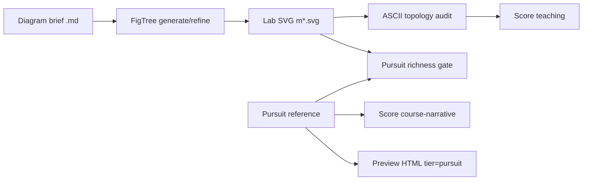

# Course narrative figures — strategy (FigTree × Pursuit)

## 1. Problem statement

Module 1 work proved that **teaching-rubric FigTree output** can score **10.0** while still looking like compact Langflow/Mermaid blocks (~170px tall, no inline examples). Learners and instructors expect **Pursuit-tier art**: tall panels, grounded annotations, icons, and example copy inside the SVG program.

FigTree must support **two complementary modes**, not one:

| Mode | Rubric | Output | Consumer |
|------|--------|--------|----------|
| **Lab / regression** | `teaching` | Topology-safe block diagrams | CI, adversarial harness, generator experiments |
| **Course / learner** | `course-narrative` + **Pursuit gate** | Rich narrative SVGs | `preview.html`, published courseware |

Optimizing only `teaching` will **never** produce Pursuit art; the rubric caps label count, canvas aspect, and density by design.

## 2. Ground truth: Pursuit figures

Canonical files:

`examples/figtree/langflow/pursuit/module-01/figures/01–07*.svg`

Mapping and seeding: [PURSUIT-VISUAL-BAR.md](./PURSUIT-VISUAL-BAR.md).

**Policy:** learner-facing pages **ship Pursuit tier** (or gold HTML extract until Pursuit is refreshed). Lab SVGs under `module-01/m*.svg` remain the **generator target** for iterative improvement, not the published default.

## 3. Quality model (three gates)



| Gate | Tool | Pass criteria |
|------|------|----------------|
| **Topology** | `figure_ascii_audit.py` | All brief `->` components present; no canvas clip |
| **Lab regression** | `figtree score --rubric teaching` | ≥ 9.86 on lab SVG (optional refine) |
| **Narrative / Pursuit** | `pursuit_gate.py` + `course-narrative` score | Candidate within Pursuit metrics **or** is Pursuit; narrative score ≥ 8.5 on Pursuit refs |

Richness compares **annotation count, text nodes, canvas height, block count** against Pursuit (ratio thresholds, with skips when reference has zero annotations).

## 4. FigTree product: `course-narrative` rubric

Added in `figtree/rubrics.py`:

- Medium: **course narrative** (course companion, not paper/teaching blocks)
- Taller canvas aspect band, higher label word budget, semantic coverage weighted up, compactness weighted down
- Quality checks: minimum canvas height, narrative support text when many blocks, panel-style structure

Style preset **`course-narrative`** in `figtree/styles.py` (teaching palette, larger vertical rhythm) for `figtree generate --style course-narrative`.

## 5. Pipelines (commands)

**Publish path (what learners see):**

```bash
python3 examples/course/agentic-ai-langflow/scripts/seed_pursuit_figures.py   # or copy local Pursuit exports
python3 examples/course/agentic-ai-langflow/module-01/build_module_html.py --tier pursuit
python3 examples/course/agentic-ai-langflow/scripts/run_course_narrative_gate.py
```

**Lab / generator path (what agents iterate):**

```bash
python3 examples/course/agentic-ai-langflow/module-01/build_figures.py
python3 examples/course/agentic-ai-langflow/scripts/figure_ascii_audit.py
python3 examples/figtree/langflow/adversarial/run_module_adversarial.py \
  examples/course/agentic-ai-langflow/module-01 \
  docs/course/agentic-ai-langflow/module-01/diagrams \
  --gold examples/course/agentic-ai-langflow/module-01/gold \
  --rubric teaching
```

**Closing the gap (future loop):** refine lab SVGs with `--rubric course-narrative --reference pursuit/...` (CLI hook), measure `pursuit_gate` delta each round; do **not** delete nodes for compactness.

## 6. Module 1 rollout order

1. **Done:** Pursuit tree, tier resolver, preview `--tier pursuit`, ASCII audit, teaching lab fixes.
2. **This pass:** `course-narrative` rubric, Pursuit gate CI, narrative adversarial runner, strategy docs.
3. **Next:** Per-figure `--request` refine from brief + Pursuit diff; optional `course-narrative` generate from enriched briefs (m1b, capstone first).
4. **Later modules:** Repeat manifest + Pursuit `figures/` + gate before preview.

## 7. Success criteria

- Pursuit `03-four-parts-real-contents.svg` scores **≥ 8.5** on `course-narrative` with source brief.
- Lab `m1b.svg` **fails** `pursuit_gate` vs Pursuit (documents intentional gap).
- `preview.html` uses Pursuit tier; CI fails if Pursuit references fail narrative gate or topology audit on mapped course IDs.
- Documentation states clearly: **10.0 teaching ≠ Pursuit quality.**

## 8. References

- [VISUAL-SPEC.md](../../../examples/course/agentic-ai-langflow/VISUAL-SPEC.md)
- [PURSUIT-VISUAL-BAR.md](./PURSUIT-VISUAL-BAR.md)
- FigTree rubrics: `figtree/rubrics.py`, specs: `figtree/rubric_spec.py`
